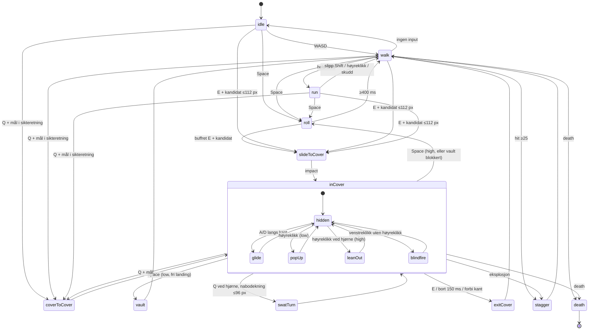

# WARDEN – animasjon, tilstander, kontroller og trefflengder

Eier: Breach Karakter. Gjelder `game/src/player/`. `docs/PROSJEKT.md` og `docs/CORE-API.md` gjelder foran dette dokumentet.
Utseende, rigg, ledd og gjenbruk for fiender står i `docs/KARAKTER-SPEC.md`. Dette dokumentet eier **tallene** for tilstander, overganger, timinger, kontroller, trefflengder, hendelser og tuning. Ved konflikt gjelder dette dokumentet og `game/src/player/tuning.js`.

Konvensjoner:
- Enheter: px, px/s, ms i tabeller og kode-timere i sekunder (`dt` = `STEP` = 1/60 s, jf. `core/loop.js`). 1 rute = 32 px.
- Vinkel 0 = øst, positiv med klokka (canvas). Lokalt riggrom: +x = fremover, +y = figurens høyre side.
- 1 tick = 16,67 ms. Varigheter er valgt slik at de passer til hele tick.
- Kamerazoom er 1,5 som standard (CORE-API). Alle mål er i verdens-px.
- Referanse: Demoen `/workspace/breach/character-demo.html` (Breach) er utgangspunktet for porten. Der tallene her avviker fra demoen, står demoverdien i parentes som «demo: …».

---

## 1. Oversikt og designprinsipper

1. **Tyngde før fart.** Warden er tung. Han når gangfart på 90 ms, stopper på 70 ms og bruker 180 ms på å komme opp i løpefart. Ingenting snur på ett tick, unntatt siktepunktet.
2. **Bevegelser man forplikter seg til.** Rull, slide inn i dekning, vault, cover-to-cover og swat-turn er låst under forflytningen og kan bare avbrytes i et definert vindu mot slutten. For tidlig input buffres i 150 ms, så det aldri føles tregt.
3. **Roadie run.** Shift gir lavt, foroverlent løp på 290 px/s med våpenet ned og torsoen låst til løperetningen. Bevegelsesretningen svinger maks 5 rad/s, og man kan ikke skyte.
4. **Snap inn i dekning er hovedøyeblikket.** E nær dekning (eller Q mot dekning lenger unna) gir 33 ms anticipation, deretter slide på 400 px/s og en **hard stopp på ett tick**. Ved stoppet kommer hitstop (riggen fryses i 2 tick), squash på 80 ms, `camera.shake(3.5, 110)`, en støvsky og et tungt fottrinn. Etter det følger settle i 120 ms, og den kan avbrytes.
5. **Overkroppen sikter, underkroppen går.** Torsoen følger musa jevnt i alle 360° via kritisk dempede fjærer på korteste vinkel. Hofta følger bevegelsesretningen. Når vridningen blir for stor, tar beina et pivot-trinn i stedet for å vri seg som gummi. Hodet leder torsoen.
6. **Lesbarhet ovenfra.** Hver tilstand skal kunne leses i silhuetten (våpenvinkel, beinposisjon, skulderbredde, hodeplassering, skygge). Detaljer og løsninger på kjente svakheter i demoen står i KARAKTER-SPEC §5.

---

## 2. Rigg – kortversjon (detaljer i KARAKTER-SPEC.md §2–4)

```
root (x,y)
 ├─ hips   hipAngle   (bevegelse)       ├─ footL/footR (verdensplantet), legL/legR, pelvis
 └─ spine  torsoAngle (sikte)           ├─ chest, pack, pauldronL/R
                                        ├─ armL/armR (2-ledds IK til våpengrep)
                                        ├─ weapon → muzzle
                                        ├─ scarf (verlet-kjede)
                                        └─ head headAngle → visor
```

### 2.1 Vinkler og begrensninger
| Størrelse | Mål | Utjevning / grense |
|---|---|---|
| `aimAngle` | `atan2(input.mouse.worldY − y, input.mouse.worldX − x)` | rå, ingen utjevning |
| `headAngle` | `aimAngle` | fjær ω 40, maks ±30° fra torso |
| `torsoAngle` | `aimAngle`, i roadie: bevegelsesretning | fjær ω 26, maks 14 rad/s (roadie 5 rad/s) |
| `hipAngle` | bevegelsesretning (+π ved backpedal) | fjær ω 12 (løp 16) |
| vridning | `twist = wrap(torso − hip)` | **bevegelse:** hofta klemmes til ±70° (demo 69°). **Hard:** ±85° (demo 83°), klemmes etter fjærsteget |
| pivot-terskel | stillestående, \|twist\| > 60° (demo 60°) | pivot-trinn, se under |

**Korteste vinkel:** `wrap(a) = a − 2π·floor((a + π)/(2π))`. Fjæren regner alltid på `e = wrap(target − a)`, og `a` wrappes etter hvert steg, så det blir ingen hopp ved ±π. `core/geom.angleDiff(a, b)` gir det samme og kan brukes.

**Kritisk dempet fjær (per tick, semi-implisitt Euler):**
```
e = wrap(target - a);  v += (ω*ω*e - 2*ω*v)*dt;  v = clamp(v, -maxRate, maxRate);  a = wrap(a + v*dt)
```
Innsvingning (95 %) ≈ 4,74/ω: hode 120 ms, torso 180 ms (demo: eksponentiell lerp k = 16 ≈ 190 ms), hofte 400 ms.

**Bevegelse samtidig med sikte:** `d = |wrap(moveDir − aimAngle)|`
- d ≤ 70°: forover, `hipTarget = moveDir`.
- 70° < d < 115°: strafe, `hipTarget = moveDir` klemt til |twist| ≤ 70°, med sidesteg.
- d ≥ 115°: backpedal, `hipTarget = moveDir + π` og gangsyklusen baklengs. Man går ut igjen ved d < 100° (hysterese, demo 117°/100°).

**Pivot-trinn:** varighet `140 + 120·|Δ|/π` ms (180–260), easeInOutSine. Bakre fot løftes først, og hver fot får sin halvdel av tiden. Hver landing sender `footstep`. Når musa roterer kontinuerlig, kjedes pivot-trinnene.

### 2.2 Gange og fotplanting (uten skøyting)
Støttefoten er låst i verdenskoordinater. Svingfoten går til `hip + R(hipAngle)·(L/2, ±spread)` med easeInOutSine og løft = skala 1,16 (som i demoen). Fasen øker med `distanse / (2L)` per syklus, slik at støttefoten beveger seg bakover nøyaktig like fort som kroppen. Foten tvangsløftes hvis den havner mer enn 1,4·L fra hofta (knockback).

| Gangart | Fart px/s | L px/steg | Steg/s | Sidespredning |
|---|---|---|---|---|
| Gå | 180 (demo 190) | 26 | 6,9 | ±6 |
| Gå med sikte | 115 (demo 118) | 20 | 5,8 | ±6 |
| Backpedal med sikte | 92 | 18 | 5,1 | ±6 |
| Roadie run | 290 (demo 330) | 40 (demo 36) | 7,3 | ±6,5 |
| Gli i dekning | 95 (demo 95) | 12 (demo 11) | 7,9 | ±7 |

Under 18 px/s (demo 18) går føttene til hvile (0, ±6) over 120 ms med et siste `footstep`.

---

## 3. Tilstandsmaskin

### 3.1 Tilstander
Hovedmaskinen styrer root og underkroppen. **Overlag** (aim, fire, reload, grenade, flinch) er timere og flagg på overkroppen, så man kan gå, sikte og lade samtidig.

| Tilstand | Inn | Ut | Fart px/s | Varighet ms | Avbrytbarhet / buffer | Iframes |
|---|---|---|---|---|---|---|
| `idle` | ingen input, fart < 18 | alle | 0 | – | alltid | – |
| `walk` | input | alle | 180 | – | alltid | – |
| `run` (roadie) | Shift holdt + input, ikke høyreklikk | walk, slideToCover (E/Q), roll (Space) | 290 | oppstart 180 | alltid. Høyreklikk eller venstreklikk gir 120 ms nedbremsing til `aim` | – |
| `aim` (overlag) | høyreklikk holdt, **eller** skudd (holdes 450 ms etter siste skudd, som i demoen) | – | 115 | inn 120 / ut 100 | alltid | – |
| `fire` (overlag) | venstreklikk, `aimBlend` > 0,35 | – | uendret | 100 per skudd, blindfire 140 | overlag | – |
| `reload` (overlag) | R, eller klikk med tomt magasin | – | ×0,85 | 1800 (aktiv reload §4.3) | roll/slide/vault avbryter, så fortsetter reload | – |
| `roll` | Space utenfor dekning, eller Space i high cover (eller low cover når vault er blokkert) | walk/run/idle, slideToCover (buffret E/Q) | profil, totalt 130 px | **500** (demo 620) | låst 0–400, buffer fra 250, kansellerbar ≥ 400 | 60–300 |
| `slideToCover` | E med kandidat ≤ 112 px (§5.3) | inCover | 0 → 400 på 50 ms, deretter konstant | 33 + d/400 + hitstop 33 + impact 80 (maks ≈ 520) | låst til impact er ferdig, buffer hele veien | – |
| `inCover.hidden` | etter slide, dash, swat | glide, popUp, leanOut, blindfire, vault (Space, low), roll (Space, high), dash/swat (Q), exit (E) | 0 | settle 120 (kansellerbar) | alltid | – |
| `inCover.glide` | input langs kanten | hidden, exitCover (forbi kant) | 95 | – | alltid | – |
| `popUp` (low) | høyreklikk, sikte innenfor ±80° av −normal | hidden | 0 | opp 140 / ned 120 | alltid. Skudd fra 100 ms | – |
| `leanOut` (high) | høyreklikk og ≤ 32 px fra konveks ende (demo 34) | hidden | root forskyves 20 px (demo 20) | ut 160 / inn 140 | alltid. Skudd fra 120 ms | – |
| `blindfire` | venstreklikk i dekning uten høyreklikk | hidden | 0 | løft 100, holdes 300 etter siste skudd (demo 300) | alltid | – |
| `coverToCover` | Q med mål i sikteretningen (både i og utenfor dekning) | inCover | løp 360 (demo), slide de siste 85 px | 33 + reise + 33 + 80 | som slide | – |
| `swatTurn` | Q ved hjørne (`atCorner`) når målet er nabodekning ≤ 96 px over gapet på samme linje | inCover | profil | 300 | låst 0–240, buffer fra 150 | – |
| `vault` | Space i low cover, landingsplass fri | walk/run | profil | 400 (opp 80 / over 220 / ned 100) | låst 0–330, buffer fra 220 | – |
| `exitCover` | E, retning bort fra dekning holdt 150 ms, glid forbi kant 200 ms, eller sikte > 100° bakover med høyreklikk | idle/walk/aim | 0 → 70 (demo) → normal | 160 | kansellerbar ≥ 80 | – |
| `grenade` (overlag) | G holdt (bue), slipp = kast via `spawnGrenade` (Våpen) | – | ×0,7 mens G holdes | windup 220, slipp 260, recovery 240 | våpenet er låst 220–500 | – |
| `flinch` (overlag) | `hit` < 25 skade | – | uendret | 120 | additivt | – |
| `stagger` | `hit` ≥ 25 eller eksplosjon ≤ 64 px | idle/walk, eller hidden hvis han var i dekning | knockback 140 → 0 | 380 | låst 0–260, buffer fra 160 | – |
| `death` | `death`-hendelse med `target === player` | – | glir 20 px | 1100 | ingen | – |

**Ikke skudd** i `run`, `roll`, `slideToCover`, `coverToCover`, `swatTurn`, `vault` eller `stagger`. Klikket buffres i 150 ms.

### 3.2 Diagram


### 3.3 Overgangstabell (prioritet ovenfra og ned, første treff vinner)
| Fra | Input / hendelse | Til | Merknad |
|---|---|---|---|
| alle | `death` (target = player) | `death` | `coverExit` sendes hvis han var i dekning |
| alle unntatt death og roll med iframes | `hit` ≥ 25, eller `explosion` ≤ 64 px | `stagger` | i dekning: på stedet, uten knockback |
| idle/walk/run | E, kandidat ≤ 112 px (§5.3) | `slideToCover` | coyote 100 ms |
| idle/walk/run | Q, mål i sikteretningen (40–320 px, ±18°) | `coverToCover` | uten mål: ingenting, «nekt»-lyd og buffer 150 ms |
| idle/walk/run | Space | `roll` | retning: input, ellers fart (> 30 px/s), ellers torso (som i demoen) |
| walk | Shift holdt + input, ikke høyreklikk | `run` | slipp Shift: `walk` |
| inCover, low | Space, landingsplass fri (§5.4) | `vault` | retning: −normal (over dekningen) |
| inCover, low | Space, landingsplass blokkert | `roll` | som high |
| inCover, high | Space | `roll` | retning: input hvis den ikke peker inn i dekningen, ellers langs normal. `coverExit {reason:'roll'}` |
| inCover, `atCorner` | Q, mål er nabodekning ≤ 96 px over gapet på samme linje | `swatTurn` | |
| inCover | Q, mål i sikteretningen (40–320 px, ±18°) | `coverToCover` | egen dekning hoppes over |
| inCover | E | `exitCover` | |
| inCover | bort fra dekning holdt 150 ms / glid forbi kant 200 ms | `exitCover` | korte trykk ignoreres |
| inCover | høyreklikk, sikte > 100° fra −normal | `exitCover` → `aim` | |
| låste tilstander | buffret input | ved første kansellerbare tick | buffer 150 ms, siste input vinner |

---

## 4. Timinger og kurver

### 4.1 Hovedtabell
| Handling | Faser ms | Kurve | Squash / positur | Kamera (`world.camera.shake(px, ms)`) | Annet |
|---|---|---|---|---|---|
| Gå akselerasjon / brems | 90 / 70 | lineær | follow-through: torso 2 px fram ved stopp, tilbake på 120 ms | – | |
| Roadie start / stopp | 180 / 140 | easeOutQuad / easeOutCubic | torso 3,5 px fram (demo), våpen −54° (demo `sprint`-pose) | – | stopp: `footstep kind:'scrape'` |
| Aim inn / ut | 120 / 100 | easeOutCubic | våpen rett fram, skuldre ×1,04 | core-kamera: lead 0,32, klemt ±140/±95 px | |
| **Rull (kollbøtte)** | dykk 0–90 · rulle 90–330 · lande 330–420 · reise seg 420–500 | fart: 0,7×topp ved start, topp 420 px/s ved 90 ms, easeOutCubic ned til 160 ved 420 | se KARAKTER-SPEC §5.1 | 1,5 px / 60 ms ved landing (330) | iframes 60–300. Utgangsfart 170 i rulleretningen (demo) |
| **Slide til dekning** | anticipation 33 · ramp 50 · reise d/400 · **hitstop 33** · impact 80 · settle 120 | ramp easeOutQuad, deretter konstant. Magnet de siste 30 % av distansen. **Farten til 0 på ett tick** | anticipation: hodet 3 px fram. Slide: framfoten strekkes 14 px mot dekningen (KARAKTER-SPEC §5.2). Impact: ×0,88 langs normal, ×1,08 langs tangent, ut med easeOutBack | 3,5 px / 110 ms × (innfart/400) | støvsky 14 partikler og 7 småbiter (som i demoen). `coverImpact` |
| Cover-to-cover | 33 + løp 360 px/s + slide de siste 85 px + hitstop + impact + settle | løp: lerp mot 360 (k = 10, demo) | lav, sprint-positur 0,7 | 3 px / 100 ms | |
| Swat-turn | krysse 0–240, lande 240–300 | easeInOutQuad, bue | lav (×0,92) | 1,5 px / 60 ms | |
| Vault | opp 0–80 · over 80–300 · ned 300–400 | easeInOutSine | skala 1,0 → 1,12 → 1,0, skyggeforskyvning 3 → 9 → 3 px | 2 px / 80 ms ved landing | 2 × `footstep kind:'land'` |
| PopUp | 140 / 120 | easeOutCubic / easeInQuad | høyde 0,86 → 1,0 (demo `hT`) | – | |
| LeanOut | 160 / 140 | easeOutCubic | hofta vrir 17° mot hjørnet (demo 0,3 rad) | – | |
| Blindfire | løft 100, senk etter 300 | easeOutQuad | armer og våpen fram over kanten (demo `blind`-pose), hodet nede | – | |
| Skudd | 100 (blindfire 140) | rekyl: 1 tick ut, demping k = 16 | våpen 3,2 px bak, torso ±1,7° tilfeldig −1,1° (demo) | 0,9 px / 60 ms (blindfire 0,7) | munningsglimt 55 ms, hylse |
| Reload | 1800 | magasin ut 0–300, inn 900–1200, ladehåndtak 1500–1700 | venstre hånd til magasin og belte | – | |
| Granat | 220 / 260 / 240 | easeInQuad / easeOutQuad | torso −25° i windup, +15° i follow-through | – | |
| Pivot-trinn | 180–260 | easeInOutSine | – | – | 2 × `footstep` |
| Flinch | 30 ut / 90 inn | easeOut | torso 4° bort fra kilden, 2 px, hvitt blink 60 ms | 1 px / 50 ms | |
| Stagger | 380 | knockback 140 px/s, halveringstid 60 ms | torso 18° bort fra kilden, våpen ned | 4 px / 140 ms | |
| Død | fall 0–450, glid og settle 450–1100 | easeInQuad | ligger flat langs treffretningen, visiret slukker over 400 ms | 5 px / 200 ms | |

### 4.2 Input-buffer, coyote og filtre
- **Buffer 150 ms (9 tick)** for Space, E, Q, R, G, venstre- og høyreklikk. Bare siste handling beholdes.
- **Coyote for dekningssnap 100 ms (6 tick).** Den siste gyldige E-kandidaten huskes. Det gjelder også fra `roll` etter 250 ms.
- **Utgangsfilter:** retning bort fra dekningen må holdes i 150 ms før `exitCover`.

### 4.3 Aktiv reload (kan slås av med `activeReload: false`)
Nytt trykk på R mens reload pågår:
- 700–820 ms: **perfekt**. Ferdig straks, og skade ×1,15 i 5 s.
- 820–1000 ms: **god**. Ferdig straks.
- Ellers i 300–1700 ms: **jam**. Ferdig ved 2500 ms.

### 4.4 Helse og regenerering (Gears-stil, eies av spilleren)
Ingen down-but-not-out. Skade går via core `damage()` og setter `hp`/`dead`. Spilleren eier bare regenereringen og tilstanden under.

| Tilstand (`player.health`) | Inn | Regel |
|---|---|---|
| `full` | `hp === maxHp` | ingenting |
| `wounded` | `hit` med `target === player` og `amount > 0` | `lastDamageAt = world.time`. Hvert nytt treff nullstiller ventetiden |
| `regen` | `world.time − lastDamageAt ≥ 3,0 s` | `hp += 34·dt` (fra 0 til fullt ≈ 2,9 s). De første 0,25 s rampes raten lineært opp fra 0. Til `full` når `hp ≥ maxHp` |
| `dead` | core `death` | regen stopper |

- Ventetiden er 3,0 s uansett tilstand. Dekning gir ikke raskere regen, men skjult positur (`coverHitChance` 0,1) gjør at man får fred til å regenerere.
- `hp` klemmes til `maxHp`. Regen påvirker ikke `armor`/`invuln`.
- Hendelse: `playerHealth {hp, maxHp, health, delta}` ved tilstandsbytte og hvert 0,25 s under `regen` (ikke per tick).

**HUD-forslag – «crimson omen»-vignett** (eies av HUD-rollen, bare forslag):
- Rød vignett (`#8b0000` → transparent, radial fra kantene) med styrke `v = clamp((0,75 − hp/maxHp)/0,6, 0, 1)`. Ved full helse er den usynlig.
- Under 35 %: en crimson omen-hodeskalle/tannhjul i skjermens midte (alfa 0,15 + 0,35·v), som pulserer i hjerteslag: 1,2 Hz, økende til 1,8 Hz under 15 %. Desatureringsfilter 0,4·v på verden.
- Hvert treff: blink +0,25 i vignettstyrken som avtar over 200 ms. Ved `regen` fader vignetten med hp, og omenet slukker over 300 ms når hp > 50 %.

---

### 4.5 Nærkamp – geværkolbeslag (`melee`, tast F)

Lagt til 23.10.2026 ved porteringen. Skade, treff, rekkevidde (41,6 px), bue (100°), knockback og stagger på mål eies av
`weapons/melee.js` (`wpn.tryMelee`). Spilleren eier bare tilstand, animasjon, steg og hitstop – ingen skadelogikk dupliseres.

**Timinger (rigg-klipp `melee`, 0–520 ms):**

| Fase | Tid | Hva skjer | Kobling til weapons |
|---|---|---|---|
| windup | 0–120 ms (0,12 s) | Torso vris −0,62 rad bort fra målet, rotsenter −2 px bak, geværet trekkes tilbake med kolben bakerst. Skjerf og sekk henger igjen (sekundærbevegelse). | `'melee' {phase:'start'}` → `startMelee` |
| strike | 120–220 ms (0,10 s) | Torso vris til +0,26 rad, kolben foran (pose `meleeStrike`), lunge +7 px, kroppssteg 9 px fram (`meleeStep`), squash/stretch 1,10/0,94, svak smear (2 buer, alfa 0,16 – weapons tegner hovedbuen). Visuell kontakt ved ≈165 ms. | `'melee' {phase:'hit'}` kommer ved 120 ms (slutten av weapons-windup) |
| recover | 220–520 ms (0,30 s) | Torso og gevær glir tilbake til siktepose (easeInOutSine). Skjerf/sekk svinger ut. | `'melee' {phase:'end'}` ved 320 ms |

- **Hitstop:** bare ved treff (`hit` med `targets.length > 0`): 33 ms frys (`meleeHitstop`) ved visuell kontakt (≈165 ms).
  Kameraristing eier weapons (rister ved treff når `camera.target === e`); spilleren rister ikke selv.
  `meleeShake`/`meleeShakeMs` i tuning er reservert og ubrukt, slik at vi ikke får dobbel risting.
- **Bevegelse:** 35 % fart under hele angrepet (`meleeMoveMul`). Ingen sprint.
- **Trefflengde:** `r = 13` (melee). Ingen invuln, ingen ekstra armor.

**Overganger inn:**

- Fra `move` (også under sprint – sprint avbrytes) og fra `cover` (alle undertilstander). Fra dekning forlater Warden dekningen
  først: skyves 7 px ut fra veggen (`meleeCoverPush`), `coverExit` sendes, og slaget starter samme ramme.
- Ikke fra `roll`, `slide`, `vault`, `stagger`, `death` eller `melee`. F bufres i 0,15 s (`inputBuffer`), så F trykket sent i et
  rull/slide gir slaget straks tilstanden slipper.
- Weapons' nedkjøling (0,7 s) gjelder fortsatt: avvist `tryMelee` gir ingen animasjon (animasjonen starter bare på `'start'`-hendelsen).

**Avbrytbarhet:**

| Når | Hva kan avbryte |
|---|---|
| 0–320 ms | Bare `death` og `stagger` (treff ≥ 25 hp eller eksplosjon nær). Bevegelsesinput gir bare 35 % fart. |
| etter 320 ms (`meleeCancelAt`) | Space (rull), E (dekning), sprint kansellerer resten av recover. Siktet skyting er sperret til tilstanden er ute av `melee`. |
| 520 ms | Automatisk tilbake til `move`. |

**Overganger ut:** `move` (normalt), `roll`/`cover`/`move`+sprint (kansellering etter 320 ms), `stagger`, `death`.

**Kjent avvik:** spillerens hitstop fryser `st.t`, mens weapons' klokke går videre, så weapons' `end` kan komme ≈33 ms før
spillerens recover er like langt. Ufarlig, men en `hitstop`-hendelse fra core ville løst det.

## 5. Kontroller og dekningsdeteksjon

All input leses fra `world.input` (`core/input.js`): `input.down(code)`, `input.pressed(code)` (gjelder ett 60 Hz-steg) og `input.mouse.{worldX, worldY, left, right, leftPressed, rightPressed, wheel}`. Warden legger sin egen 150 ms-buffer oppå `pressed`.

### 5.1 Tastatur og mus (Alexanders oppsett – låst)
| Tast | Handling (Alexanders oppsett, ordrett) |
|---|---|
| WASD | bevegelse |
| Mus | sikter |
| E | inn/ut av dekning |
| Q | rask forflytning til ny dekning |
| Space | rull / hopp over dekning (vault når du er i lav dekning, ellers rull) |
| Shift | hold for å spurte |
| Høyre mus | presis sikting over dekning (popUp/peek) |
| Venstre mus | skyt (blindfire i dekning uten høyre mus) |
| R | lad om |
| G | granat |

Implementasjon (`KeyboardEvent.code`): `KeyW/A/S/D`, `KeyE`, `KeyQ`, `Space`, `ShiftLeft`/`ShiftRight` (holdt = roadie run), `KeyR`, `KeyG`, `mouse.left`/`mouse.right`. Detaljer: Høyre mus gir popUp i low cover, leanOut (peek) ved hjørne i high cover og presist sikte utenfor dekning. Nytt R-trykk under reload er aktiv reload (§4.3). G holdes for bue mot muspekeren (maks 288 px) og kastes ved slipp.

Space er **ikke** en kontekstknapp. Den gjør bare to ting: vault i low cover (når landingen er fri), ellers rull. Inn i dekning skjer bare med E (nærmeste) eller Q (i sikteretningen). Core stopper nettleserens standardoppførsel for Space, Shift og høyreklikk (`core/input.js`).

### 5.2 Gamepad (forslag, krever støtte i `core/input.js`)
Speiler tastaturet: venstre stikk bevegelse (dødsone 0,18), høyre stikk sikte (dødsone 0,25, forrige vinkel beholdes). RT = venstre mus, LT = høyre mus, A = Space, B = E, LB = Q, L3 (hold) = Shift, RB = G, X = R.

### 5.3 Dekningsdeteksjon med core
Byggesteinene er `nearestCover(world, x, y, maxDist, {filter})`, `raycastCover(world, ax, ay, bx, by, {types, pad})` og `closestPointOnRect` fra `core/geom.js`.

1. **Kandidatsøk (E):** Først `nearestCover(world, x, y, 112, { filter })`, der `filter(c)` regner `p = closestPointOnRect(c, x, y)` og godtar dekning der vinkelen fra `moveDir` (står han stille: sikteretningen) til `(p − pos)` er innenfor ±45°. Finnes ingen, brukes `nearestCover(world, x, y, 112)` uten filter (nærmeste, som i demoen). Ved avstand under 20 px godtas alt, fordi han da allerede står inntil.

   | Kilde | Radius px | Kjegle |
   |---|---|---|
   | E | 112 (demo 150) | foretrekker ±45° bevegelses-/sikteretning, ellers nærmeste |
   | Q (i og utenfor dekning) | 320 (demo 420), minst 40 | ±18° sikte, 15 stråler (demo) |
2. **Flate:** `normal` fra `nearestCover` snappes til en akse: |nx| > |ny| gir (sign nx, 0), ellers (0, sign ny). Ved et hjørne (||nx| − |ny|| < 0,2) velges flaten med størst `dot(n, −moveDir)`. Er det uavgjort (< 0,1), velges flaten nærmest sikteretningen.
3. **Snap-punkt:** Langs flaten klemmes posisjonen til `[ende + 9, ende − 9]` (demo 9). Ut fra flaten er avstanden `coverStandoff` = 15 px (demo `CR = 15`).
4. **Fri bane:** `raycastCover(world, x, y, Sx, Sy, {types:['low','high'], pad: 11})`. Treff på annen dekning enn målet forkaster kandidaten.
5. **Magnet:** De siste 30 % av sliden lerpes mot S. Maks sidekorreksjon er 24 px.
6. **Q / cover-to-cover:** Stråler med `raycastCover` per vinkel, `types:['low','high']`. Egen dekning hoppes over hvis den treffes før målet (demo `findDashTarget`). Flaten tas fra strålens `nx, ny`.
7. **Dekningslinjer:** Flater på linje (samme normal, ±2 px) med gap ≤ 6 px slås sammen ved `init` og ved `arenaLoaded`, slik at man glir sømløst langs kasser som står inntil hverandre.
8. **I dekning:** Posisjonen settes direkte på linjen (som i demoen). Input projiseres på tangenten, og farten jevnes (k = 10) mot 95 px/s. Ved en konveks ende stopper han 9 px inn. Holdes retningen ytterligere 200 ms, blir det `exitCover`. `atCorner` er sann når enden er ≤ 32 px unna.
9. **Kollisjon:** Etter hver forflytning utenfor dekning kalles `resolveCircleVsCover(world, player, 12)` med eksplisitt r = 12, fordi `player.r` brukes som treffradius (§6). Spilleren setter også `player.collisionR = 12`. Maks forflytning per tick er 420/60 = 7 px, under 12, så det blir ingen tunnelering.
10. **Myk separasjon mot fiender:** `separateActors(world, dt)` fra `game/src/shared/separateActors.js` kalles én gang per steg etter at spiller og fiender har flyttet seg. Den skyver sirkler fra hverandre med fjær (14/s, maks 2,5 px per tick), ignorerer `dead`, flytter aldri en entitet med `inCover`/`immovable`, og skyver aldri noen inn i dekning (bruker `collisionR ?? r` og core `resolveCircleVsCover`). Massene er spiller 1,5, Heavy 3, Flanker 0,8 og ellers 1. Ingen hard kroppsblokkering.

### 5.4 Low vs high
| | Low | High |
|---|---|---|
| Skjult positur | kneler (høyde 0,86), framfot og bakkne synlige | står mot veggen (høyde 0,88) |
| Sikte | popUp hvor som helst | leanOut bare `atCorner`. Midt på vises hinttekst «Gå til kanten av muren for å kikke ut» (demo) |
| Blindfire | over kanten | rundt hjørnet (`atCorner`) |
| Space | vault (dybde ≤ 48 px, landingsplass fri), ellers rull | rull |
| Siktebue | ±80° fra −normal | ±80° fra −normal, fra forskjøvet posisjon |

---

## 6. Trefflengder og hitboxer

Core treffer med **én sirkel** `e.r` rundt `(e.x, e.y)` (`combat.updateProjectiles`). Warden setter `player.r` per tilstand (godkjent av Breach, uten treff-offset). Kollisjon bruker alltid 12 via `resolveCircleVsCover(world, player, 12)`. «–» i `coverHitChance` betyr at feltet slettes (`delete player.coverHitChance`), så core bruker standard 0,35.

| Tilstand | `player.r` | `coverHitChance` | `player.armor` | `player.invuln` | `exposed` / `exposure` |
|---|---|---|---|---|---|
| idle / walk / aim | 13 | – | 0 | – | true / 1,0 |
| run | 12 | – | 0 | – | true / 1,0 |
| roll | 10 | – | 0 | **true** i 60–300 ms | true / 1,0 |
| slide / dash / swat / vault | 12 | – | 0 | – | true / 1,0 |
| inCover hidden (low/high) | 11 | **0,1** | 0 | – | false / 0,1 |
| popUp | 12 | **0,6** | 0 | – | true / 0,6 |
| leanOut | 11 (posisjonen er forskjøvet 20 px) | 0,6 | 0 | – | true / 0,6 |
| blindfire | 11 | **0,25** | 0,5 | – | delvis / 0,25 |
| stagger | 13 | – | 0 | – | true / 1,0 |

Beskyttelse bak low cover: Core bruker `entity.coverHitChance` hvis den er satt, ellers 0,35, for mål ≤ 48 px bak low cover. Han står 15 px fra flaten og er derfor alltid innenfor. Verdien settes ved hvert tilstandsbytte. High cover stopper alt. LeanOut (high) bruker 0,6 i tilfelle low cover ligger mellom.

**Munning (spawnpunkt for prosjektil), torso-rom, i sikteposituren til demoen:**
| Positur | (fwd, right) px | Merknad |
|---|---|---|
| Sikte / hofteskudd / popUp | (36, 4) | demo (37,5; 3,6). Hofteskudd blander alltid inn sikteposituren |
| LeanOut | (36, 4) fra forskjøvet root | |
| Blindfire | (46, 2) | armene strakt fram over kanten (demo `blind`-pose) |
| Vinkel | posens våpenvinkel. Ved sikte snappes den mot musa hvis avviket er < 20° (demo) | |

Egen low cover ignoreres av core når den ligger ≤ 40 px fra munningen (`SHOOTER_IGNORE`), så blindfire og popUp trenger ingen spesialregel. Ved leanOut må munningen ligge utenfor high-dekningens plan. Det er garantert når forskyvningen er 20 px og munningen 36 px fram.

**Spredning (halv vinkel):** hoftesikte 5,0° (demo 0,09 rad), i bevegelse 6,0°. Sikte 1,0° (demo 0,018 rad), i bevegelse 1,8°. PopUp 1,0°. LeanOut 1,4°. Blindfire 11,5° (demo 0,2 rad). Bloom: +0,4° per skudd, maks +3°, avtar med 8°/s.
**Prosjektil:** `spawnProjectile(world, {x, y, angle, speed: 950, dmg: 10, team:'player', owner: player, weapon:'rifle', blind})`. De ekstra feltene havner på prosjektilet og dermed i `shot`-payloaden.

---

## 7. Hendelser (`world.events`)

**Core sender, og Warden sender ikke selv:** `shot` (fra `spawnProjectile`), `hit`, `death`, `coverHit`, `projectileHit`.

**Warden sender:**
| Navn | Payload | Når |
|---|---|---|
| `coverEnter` | `{entity: player, cover, nx, ny, type, x, y, atCorner, via:'slide'|'dash'|'swat'|'e'}` | ved impact (CORE-API `{entity, cover}` + tillegg) |
| `coverExit` | `{entity: player, cover, reason:'move'|'e'|'roll'|'vault'|'dash'|'stagger'|'death'}` | ved utgang |
| `coverImpact` | `{entity, x, y, nx, ny, strength}` | ved impact, for lyd og arena-støv |
| `footstep` | `{entity, x, y, foot:'L'|'R', speed, kind:'walk'|'run'|'land'|'scrape', surface?}` | ved hver planting |
| `roll` | `{entity, x, y, angle}` | rullestart |
| `vault` | `{entity, cover, fromX, fromY, toX, toY}` | vaultstart |
| `reload` | `{entity, phase:'start'|'end', result:'normal'|'perfect'|'good'|'jam'}` | |
| `playerHealth` | `{hp, maxHp, health:'full'|'wounded'|'regen'|'dead', delta}` | §4.4 |
| `playerState` | `{from, to}` | ved tilstandsbytte (HUD, lyd, debug) |

**Granat:** Breach Våpen eier granaten (`spawnGrenade` og hendelsen `explosion` i `game/src/weapons/`). Ved slipp av G kaller Warden `spawnGrenade(world, {x, y, tx, ty, team:'player', owner: player})` med start i håndsocket (`rig.socket('throwHand')`) og mål = muspekeren klemt til 288 px. Endelig signatur og eventuell `grenade`-hendelse eies av Våpen. Warden sender ikke noe granatevent selv.

**Warden lytter på:**
| Navn | Reaksjon |
|---|---|
| `hit` med `target === player` | flinch eller stagger, og `lastDamageAt` (§4.4). Retning fra `source.projectile.vx/vy` eller `source.owner` |
| `death` med `target === player` | `death`-tilstand |
| `explosion {x, y, radius, …}` (fra Våpen) | stagger ≤ 64 px, flinch innenfor radius |
| `arenaLoaded` | bygg dekningslinjer på nytt og nullstill tilstanden |
| `waveStart` | ingenting (regenerering fortsetter) |

**`world.player`-felt:** `x, y, r, hp, maxHp, team:'player', dead, armor, invuln, coverHitChance` (core) + `collisionR, health, lastDamageAt, state, aimAngle, torsoAngle, inCover, cover, coverNormal{x,y}, exposed, exposure, ammo, mag, grenades`.

---

## 8. Tuningkonstanter (`game/src/player/tuning.js`)

```js
const D = Math.PI / 180;
export const TUNING = {
  // kropp
  bodyRadius: 13, collisionRadius: 12, coverStandoff: 15, coverEndInset: 9,
  // fart px/s, tider i sekunder
  walkSpeed: 180, aimWalkSpeed: 115, backpedalMul: 0.8, runSpeed: 290, coverGlideSpeed: 95,
  reloadMoveMul: 0.85, grenadeAimMoveMul: 0.7,
  walkAccel: 0.09, walkDecel: 0.07, runAccel: 0.18, runDecel: 0.14, runTurnRate: 5.0,
  // vinkler og fjærer (ω rad/s)
  headOmega: 40, torsoOmega: 26, hipOmega: 12, hipOmegaRun: 16, torsoMaxRate: 14, torsoMaxRateRun: 5,
  headMaxTwist: 30 * D, twistMove: 70 * D, twistHard: 85 * D, pivotThreshold: 60 * D,
  backpedalEnter: 115 * D, backpedalExit: 100 * D,
  pivotBase: 0.14, pivotPerPi: 0.12,
  // gange px per steg
  strideWalk: 26, strideAim: 20, strideBack: 18, strideRun: 40, strideGlide: 12,
  footSpread: 6, footLiftScale: 1.16, footRestSpeed: 18, footRestTime: 0.12, footForceLift: 1.4,
  // input
  inputBuffer: 0.15, coverCoyote: 0.10, coverExitHold: 0.15, cornerExitHold: 0.20,
  // dekningssøk
  coverRadiusE: 112, coverConeE: 45 * D, coverTouchDist: 20,
  dashRadius: 320, dashMin: 40, dashCone: 18 * D, dashRays: 15,
  cornerZone: 32, coverMergeGap: 6, coverMaxLateral: 24, coverMagnetFrac: 0.3, coverPathPad: 11,
  // slide / dash
  slideAnticip: 0.033, slideRamp: 0.05, slideSpeed: 400, dashSpeed: 360, dashSlideDist: 85,
  hitstop: 0.033, impactTime: 0.08, settleTime: 0.12, impactSquash: 0.88, impactStretch: 1.08,
  impactShake: 3.5, impactShakeMs: 110, impactDust: 14, impactDebris: 7,
  // rull
  rollTime: 0.5, rollPeakSpeed: 420, rollEndSpeed: 160, rollExitSpeed: 170, rollDist: 130,
  rollIFrame: [0.06, 0.30], rollBufferOpen: 0.25, rollCancelAt: 0.40, rollCooldown: 0.25,
  // swat / vault / exit
  swatTime: 0.30, swatMaxGap: 96, swatCancelAt: 0.24,
  vaultTime: 0.40, vaultCancelAt: 0.33, vaultMaxDepth: 48,
  exitCoverTime: 0.16, exitCoverSpeed: 70,
  // dekningsposturer
  popUpTime: 0.14, popDownTime: 0.12, leanOutTime: 0.16, leanInTime: 0.14, leanOffset: 20, leanHipTwist: 17 * D,
  blindRaise: 0.10, blindHold: 0.30, coverAimArc: 80 * D, aimBackExit: 100 * D,
  hiddenHeight: 0.86, hiddenHeightHigh: 0.88,
  // våpen
  fireInterval: 0.10, blindFireInterval: 0.14, aimHoldAfterShot: 0.45, aimBlendToFire: 0.35,
  bulletSpeed: 950, bulletDmg: 10, magSize: 30, reserveAmmo: 120,
  recoilBack: 3.2, recoilDamp: 16, recoilShake: 0.9, recoilShakeMs: 60, aimSnap: 20 * D,
  spreadHip: 5.0 * D, spreadHipMove: 6.0 * D, spreadAim: 1.0 * D, spreadAimMove: 1.8 * D,
  spreadPopUp: 1.0 * D, spreadLean: 1.4 * D, spreadBlind: 11.5 * D,
  bloomPerShot: 0.4 * D, bloomMax: 3 * D, bloomDecay: 8 * D,
  muzzleAim: [36, 4], muzzleBlind: [46, 2],
  reloadTime: 1.8, activeReload: true, activePerfect: [0.70, 0.82], activeGood: [0.82, 1.0],
  activeWindow: [0.30, 1.70], activeJamTime: 2.5, perfectDmgMul: 1.15, perfectBuff: 5,
  // granat
  grenades: 2, grenadeWindup: 0.22, grenadeRelease: 0.26, grenadeRecovery: 0.24, grenadeRange: 288,
  // treff
  hitR: { stand: 13, run: 12, roll: 10, move: 12, hidden: 11, popUp: 12, lean: 11, blind: 11 },
  coverHitChance: { hidden: 0.1, popUp: 0.6, lean: 0.6, blind: 0.25 }, // ellers slettes feltet → core 0.35
  blindArmor: 0.5, staggerDmg: 25, staggerTime: 0.38, staggerCancelAt: 0.26, staggerKnock: 140,
  staggerKnockHalf: 0.06, explosionStaggerR: 64, flinchTime: 0.12, hitFlash: 0.06,
  // helse
  maxHp: 100, regenDelay: 3.0, regenPerSec: 34, regenRamp: 0.25, healthEventInterval: 0.25, deathTime: 1.1,
  // vignett-forslag (HUD)
  omenVignetteStart: 0.75, omenSymbolBelow: 0.35, omenPulseHz: [1.2, 1.8],
  // kamera: eies av core (lead 0.32, klemt ±140/±95) – ingen spillerverdier
};
```

---

## 9. Åpne spørsmål til Breach

**Åpne:**
1. **Gamepad:** Skal `core/input.js` få gamepad-støtte? Oppsettet i §5.2 speiler tastaturet.
2. **Kall av `separateActors`:** Hvem kaller den i hovedløkka (`main.js`)? Forslag: én gang per steg etter `player.update` og `enemies.update`, før `updateProjectiles`.
3. **`spawnGrenade`:** Endelig signatur fra Våpen (start, mål eller fart, lunte, team, owner). §7 bruker `{x, y, tx, ty, team, owner}` til den er klar.

**Avklart (svar fra Breach):**
- Delt rigg ligger i `game/src/shared/rig/`. Vi eier den, og Fiende-AI bruker den.
- Low cover per positur: core leser `entity.coverHitChance` (ellers 0,35). Spilleren setter 0,1 skjult, 0,6 popUp og 0,25 blindfire (§6). `player.r` per tilstand er godkjent (uten treff-offset).
- Kamera: core har lead 0,32 med grense ±140/±95 px. Spilleren styrer ikke lead.
- Heavy på 36 px er godkjent.
- Granater eies av Breach Våpen (`spawnGrenade`, `explosion` i `src/weapons`). Spilleren kaller den med G.
- Core stopper nettleserens standardoppførsel for Space, Shift og høyreklikk.
- Helse: Gears-regenerering etter 3 s uten skade, eid av spilleren (§4.4).
- Myk separasjon mellom spiller og fiender (§5.3 punkt 10), ingen hard kroppsblokkering.
- Kontrolloppsett: Alexanders oppsett (§5.1). Space er ikke kontekstknapp.
